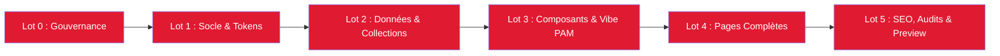

# PLAN.md — Plan Directeur par Lots MOKILI

**Projet :** Blog Mololo  
**Date :** 08 Octobre 2026  
**Statut Global :** Lots 0, 1, 2, 3, 4 et 5 complétés avec succès  

---

## Vue d'ensemble des Lots

---

### LOT 0 : Initialisation & Gouvernance MOKILI [TERMINÉ]
- [x] Inspection du dépôt et des ressources sources (`Logo Mololo sans fond.png`, `MOLOLO CHARTE & CO.pdf`)
- [x] Analyse de la référence [Pan African Music](https://pan-african-music.com)
- [x] Chargement du framework MOKILI (`.mokili/config`, Master Prompt V1.1, Site Vitrine Engine)
- [x] Diagnostic initial et cadrage validé par l'utilisateur
- [x] Création des fichiers constitutionnels : `AGENTS.md`, `MOKILI-PROJECT-SPEC.md`, `PLAN.md`, `SUIVI.md`, `README.md`

---

### LOT 1 : Socle Technique, Dépendances & Design Tokens [TERMINÉ]
- [x] Initialisation Astro v5 avec TypeScript strict et Tailwind CSS v4
- [x] Intégration des polices officielles via Fontsource (`Exo` & `Unbounded`)
- [x] Configuration des design tokens de la charte (`#e01a31`, `#fff1d9`, `#000000`, `#ffffff`)
- [x] Intégration du logo officiel sans fond dans `public/images/logo.png`
- [x] Composant réutilisable `Logo.astro` supportant les déclinaisons foncées, claires et rouges

---

### LOT 2 : Architecture Éditoriale & Collections Typées [TERMINÉ]
- [x] Définition des schémas Zod stricts (`articles`, `formats`, `playlists`) dans `src/content.config.ts`
- [x] Rédaction et intégration des 8 fiches de formats officiels (Session, Club, Radar, News, +, Episode, Playlist, Original)
- [x] Rédaction des reportages et articles culturels de lancement (Kinshasa, Jinja/Nyege Nyege, Dakar/Assiko, Abuja, Kigali, Johannesburg, Lagos)
- [x] Création de la curation musicale `Mololo Playlist Vol. 01` avec piste audio preview
- [x] Validation `astro check` : 0 erreur, 0 avertissement

---

### LOT 3 : Composants d'Interface Éditoriale — Esprit PAM [TERMINÉ]
- [x] Header éditorial avec top utility bar, logo Mololo, indicateur audio en direct et menu responsive
- [x] Ticker interactif des 8 formats officiels de Mololo
- [x] `LeadArticleCard.astro` : Cover Story asymétrique percutante à la Pan African Music
- [x] `ArticleCard.astro` : Cartes éditoriales polyvalentes (standard, horizontal, compact)
- [x] `AudioPlayer.astro` : Lecteur audio persistant avec ondes sonores et contrôle de lecture
- [x] `StudioBanner.astro` : Section manifeste et présentation du Studio Mololo
- [x] `Newsletter.astro` : Module d'inscription au Cercle Mololo avec feedback instantané
- [x] `Footer.astro` : Pied de page complet avec intégration obligatoire de `Propulsé par MOKILI` (`https://mokili.io`)

---

### LOT 4 : Pages Spécifiques du Site Vitrine [TERMINÉ]
- [x] Page d'accueil (`/`) avec Hero asymétrique, double colonne, focus playlist, fil d'actualité et manifeste
- [x] Page d'archive des articles (`/articles`) avec filtres par format et ville
- [x] Page de détail d'un article (`/articles/[slug]`) avec rendu Markdown, couverture encadrée et lecteur audio
- [x] Page index des 8 formats (`/formats`)
- [x] Page de détail dynamique d'un format (`/formats/[format]`)
- [x] Page des playlists & écoutes (`/playlists`) avec liens streaming Spotify & Apple Music
- [x] Page Le Studio & Manifeste (`/a-propos`)
- [x] Page Contact & Collaborations (`/contact`) avec formulaire et coordonnées des hubs (Kinshasa, Dakar, Lagos, Paris)
- [x] Pages légales : `/mentions-legales` et `/confidentialite`

---

### LOT 5 : Moteur SEO, Accessibilité & Compilation [TERMINÉ]
- [x] Module canonique `src/lib/seo.ts` avec balises OpenGraph, Twitter Cards et JSON-LD Schema.org
- [x] Compilation statique `npm run build` : 23 pages générées avec succès en 6.98s
- [x] Démarrage du serveur de prévisualisation et communication du lien preview

---

### LOT 6 : Modal Playlist Streaming, Carrousel Hero 5s & Partage Social [TERMINÉ]
- [x] Modal de streaming calqué sur la capture utilisateur avec sélection Spotify / Apple Music et avatar SLIMITO
- [x] Nommage strict `MOLOLO playlist` et intégration directe iframe du lecteur Spotify in-site
- [x] Carrousel Hero rotatif (5s) avec CTA adaptatif synchronisé (Lire / Regarder / Écouter / Découvrir)
- [x] Boutons de pagination « Lire plus d'articles » / « Voir tous les dossiers »
- [x] Barre de partage social pour la lecture d'article (WhatsApp, X, Facebook, Toast de copie)
- [x] Re-compilation de production (`npm run build`) validée sans erreur (23 pages)

---

### LOT 7 : Menu Tiroir Droit PAM, Player Vidéo Hero & Harmonisation Liens [TERMINÉ]
- [x] Menu hamburger refondu en tiroir coulissant à droite avec backdrop assombri (Capture PAM)
- [x] Barre de recherche, rangée sociale officielle, typographie PAM et sous-sections en double colonne
- [x] Player vidéo intégré à la hero section pour la lecture de sessions vidéo
- [x] Bouton Play circulaire épuré (▶ / ⏸) sans texte pour le lecteur audio
- [x] Section renommée en « MOLOLO SESSION »
- [x] Repositionnement de la newsletter après Mololo Session
- [x] Intégration de tous les profils officiels TikTok, Instagram, YouTube, Facebook, X, Mololo+

---

### LOT 8 : Page Écosystème, Logos de Branches & Déploiement GitHub [TERMINÉ]
- [x] Analyse approfondie des 11 planches vectorielles de `MOLOLO CHARTE & CO.pdf`
- [x] Génération des logos haute fidélité (SVG/PNG) pour chaque branche dans `public/images/ecosystem/`
- [x] Création de la page catalogue interactive `/ecosysteme/` avec redirection vers chaque branche
- [x] Bouton « Écosystème » intégré dans le menu hamburger et le footer
- [x] Compilation statique réussie : 24 pages générées sans erreur
- [x] Initialisation du dépôt Git et push vers `https://github.com/MOKILI-SAS/Mololo-Blog`

